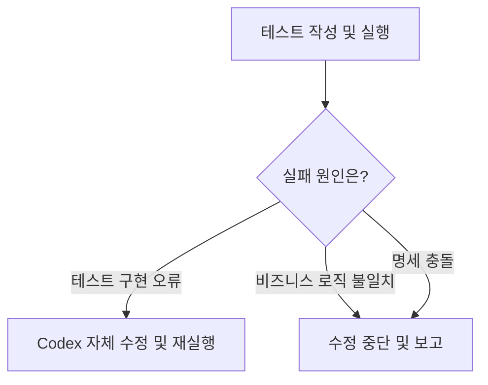

# Backend Unit Test Convention

Grimault 백엔드의 단위 테스트 작성 규약을 정의한다.

본 문서는 테스트 코드 구현을 담당하는 Codex의 공통 작업 기준이며, 개별 테스트에서 검증할 비즈니스 규칙과 기대 결과는 별도의 테스트 명세(Specification)를 따른다.

## 1. 테스트 목적 및 범위

### 목적

단위 테스트는 비즈니스 규칙의 정합성과 회귀 검증을 목적으로 한다.

> [!NOTE]
> 도메인 제약과 복합 조건 분기 등 직접 구현한 비즈니스 규칙이 이후 코드 변경에도 의도한 동작을 유지하는지 검증한다.

### 범위

- **테스트 대상:** 구현 계층과 무관하게 직접 작성한 비즈니스 규칙
- **대상 선정 기준:** 도메인 제약, 조건 복잡성, 회귀 영향도
- **테스트 유형:** 순수 단위 테스트(Unit Test)
- **HTTP 계층:** Controller 및 요청·응답 처리 검증 제외
- **영속성 계층:** Repository 및 실제 DB 동작 검증 제외
- **Spring Context:** 사용하지 않음
- **외부 의존성:** 필요한 경우에 한정해 Mock으로 격리

> [!NOTE]
> HTTP 계층과 영속성 계층의 자동화 테스트를 영구적으로 배제한다는 의미는 아니다. 현재 프로젝트 규모와 개발 목적에 따라 우선순위를 제한한다.

### 검증 책임의 경계
- Service뿐 아니라 Validator 등 다른 계층에 구현된 비즈니스 규칙도 테스트 대상으로 포함한다.
- `@NotNull`, `@NotBlank`, `@Size` 등 표준 Bean Validation 제약조건의 기본 동작은 검증하지 않는다.
- `@Valid`, `@Validated` 등을 통한 프레임워크의 검증 호출 및 연동 과정은 검증하지 않는다.
- 직접 구현한 Custom Validator의 검증 로직은 해당 메서드를 독립적으로 실행하여 검증한다.

## 2. 기술 스택

| 구분 | 기술 |
|---|---|
| 테스트 프레임워크 | JUnit 5 (Jupiter) |
| Mock 라이브러리 | MockK |
| Assertion | JUnit 기본 Assertions |
| 테스트 실행 | Gradle `test` |

> [!NOTE]
> 별도 승인 없이 테스트 프레임워크 및 라이브러리를 추가하거나 변경하지 않는다.

## 3. 테스트 작성 단위

### 시나리오 중심 작성

테스트는 서비스 메서드 자체가 아니라 **독립적인 비즈니스 검증 시나리오**를 기준으로 작성한다.

> [!NOTE]
> 하나의 검증 대상에 여러 비즈니스 규칙이 포함되어 있다면 각 규칙에 대응하는 테스트를 개별적으로 구성한다.

- 기본적으로 독립적인 시나리오마다 `@Test` 메서드 하나를 작성한다.
- 동일한 규칙에 대해 입력 데이터만 달라지는 경우 `@ParameterizedTest`를 사용할 수 있다.
- `@ParameterizedTest` 적용 여부는 전달된 테스트 명세에서 결정한다.
- 명세에 포함되지 않은 시나리오를 임의로 추가하지 않는다.

## 4. 테스트 코드 작성 패턴

### AAA (Arrange–Act–Assert)

모든 테스트는 AAA 패턴을 기본 구조로 사용한다.

| 단계 | 역할 |
|---|---|
| Arrange | 테스트 데이터 준비 및 Mock 동작 설정 |
| Act | 검증 대상 메서드 실행 |
| Assert | 반환값, 상태, 예외 및 호출 결과 검증 |

> [!NOTE]
> 각 단계의 책임을 명확하게 구분하고, 테스트의 실행 흐름을 직관적으로 파악할 수 있도록 작성한다.

### 테스트 네이밍

- 테스트 이름은 검증하는 비즈니스 규칙과 기대 결과를 드러내야 한다.
- Kotlin Backtick을 활용한 자연어 문장형 메서드 이름을 사용한다.
- 한국어 문장형 이름을 허용한다.
- 테스트 이름만으로 검증 대상과 조건 및 기대 결과를 이해할 수 있도록 작성한다.
- 전달된 테스트 명세의 시나리오 이름을 기본으로 활용한다.

## 5. Mock 및 테스트 데이터 구성

### Mock 구성

- Mock 객체는 테스트 클래스 내부에서 구성한다.
- 각 테스트 시나리오에 필요한 Mock과 Stub만 설정한다.
- 테스트와 무관한 공통 Stub 설정을 지양한다.
- 공통 Mock Factory 등 별도의 관리 계층을 선제적으로 만들지 않는다.

### 테스트 데이터

- 테스트 데이터는 메모리 객체를 사용한다.
- 실제 DB에 데이터를 생성하거나 저장하지 않는다.
- 시나리오의 검증 목적과 무관한 데이터 구성을 최소화한다.
- Test Fixture, Builder 등 공통 추상화를 선제적으로 도입하지 않는다.
- 중복 제거 및 공통화는 실제 필요성이 확인된 이후 별도로 결정한다.

> [!NOTE]
> 테스트 코드의 재사용성보다 **독립성, 명료성, 가독성**을 우선한다.

## 6. 테스트 명세와 구현의 분리

테스트 명세(Specification)와 테스트 작성 규약(Convention)은 별도로 관리한다.

### 테스트 명세

사람이 작성하고 확정하는 비즈니스 검증 요구사항이다.

개별 시나리오는 다음 항목을 기본으로 정의한다.

1. **대상:** 비즈니스 규칙이 구현된 클래스 및 검증 대상 메서드
2. **시나리오:** 검증할 비즈니스 규칙
3. **사전 조건:** 입력 데이터와 상태
4. **실행:** 검증 대상 동작
5. **기대 결과:** 반환값, 예외, 상태 변경 및 호출 여부 등

> [!IMPORTANT]
> 필요한 경우 테스트 형태(`@Test` / `@ParameterizedTest`)를 추가로 지정한다.

### 명세 관리

- 테스트 시나리오 명세는 `test-specifications`에 Markdown으로 보관한다.
- 명세는 도메인 및 비즈니스 기능 단위로 구성한다.
- 테스트 명세는 Codex의 테스트 구현 입력이자 사람이 참조하는 비즈니스 규칙 문서로 활용한다.
- 비즈니스 규칙이 변경되면 관련 명세를 먼저 갱신하고, 변경된 명세를 기준으로 테스트 코드를 수정한다.
- 명세 갱신이 누락된 테스트 변경은 정상적인 테스트 개발 절차를 완료한 것으로 보지 않는다.

### 테스트 구현

Codex는 전달받은 명세를 본 문서의 작성 규약에 따라 구현한다.

- 비즈니스 규칙을 임의로 변경하거나 재해석하지 않는다.
- 명세에 없는 테스트 케이스를 추가하지 않는다.
- 명세의 기대 결과를 실제 구현에 맞춰 임의로 수정하지 않는다.
- 명세와 실제 구현이 충돌하면 수정하지 않고 불일치 사항을 보고한다.

## 7. Codex 작업 범위

### 허용 작업

- 검증 대상 비즈니스 로직 및 관련 코드 분석
- 명세에 따른 테스트 코드 작성
- Mock 및 Stub 구성
- 작성한 테스트 실행 및 실패 원인 분석
- 테스트 구현 자체의 오류 수정

### 금지 작업

- 프로덕션 코드 및 비즈니스 로직 수정
- 명세에 없는 테스트 시나리오 추가
- 공통 Fixture, Mock Factory 등의 임의 도입
- 테스트 의존성 및 Gradle 설정 변경
- Git commit 및 push
- 테스트 시나리오 명세의 임의 작성 및 변경

> [!NOTE]
> Codex는 테스트 구현 및 실행에 자율성을 갖되, 비즈니스 규칙과 프로젝트 설정에 대한 변경 권한은 갖지 않는다.

## 8. 테스트 실패 처리

테스트 실패 시 원인을 분석하고 다음 기준에 따라 처리한다.

### 실패 처리 흐름

### 테스트 구현 오류

Mock 설정, 테스트 데이터 구성, Assertion 등 테스트 코드 자체의 오류라면 Codex가 수정하고 재실행한다.

### 비즈니스 로직 또는 명세 불일치

테스트 명세의 기대 결과와 실제 검증 대상의 동작이 일치하지 않거나, 명세 자체에 모순·불명확한 사항이 있는 경우:

- 프로덕션 코드를 수정하지 않는다.
- 테스트의 기대 결과를 임의로 변경하지 않는다.
- 수정 작업을 중단하고 불일치 사항을 보고한다.
- 사람의 판단과 지시를 따른다.

## 9. 작업 완료 보고

Codex는 테스트 작업 후 다음 항목을 보고한다.

1. 작성하거나 변경한 테스트 파일
2. 구현한 테스트 시나리오 목록
3. 테스트 실행 결과 및 성공·실패 여부
4. 명세와 구현 사이의 불일치 또는 미검증 항목
5. 구현한 테스트와 참조한 시나리오 명세 파일의 대응 관계

> [!IMPORTANT]
> 테스트가 정상적으로 통과하지 않았다면 완료된 것으로 보고하지 않는다.
